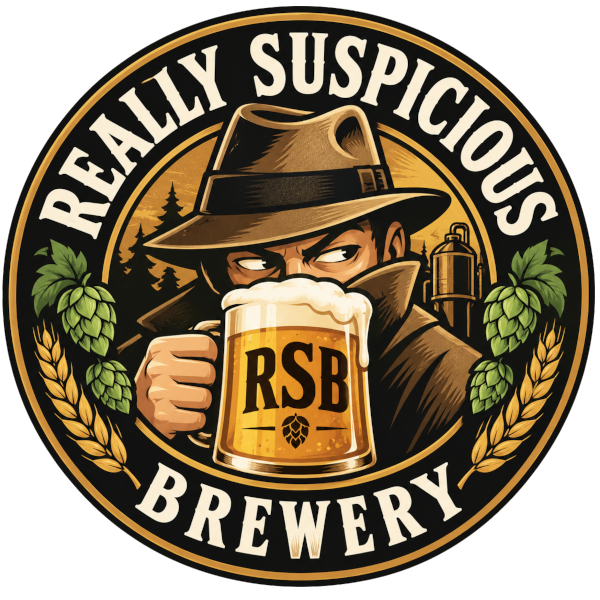
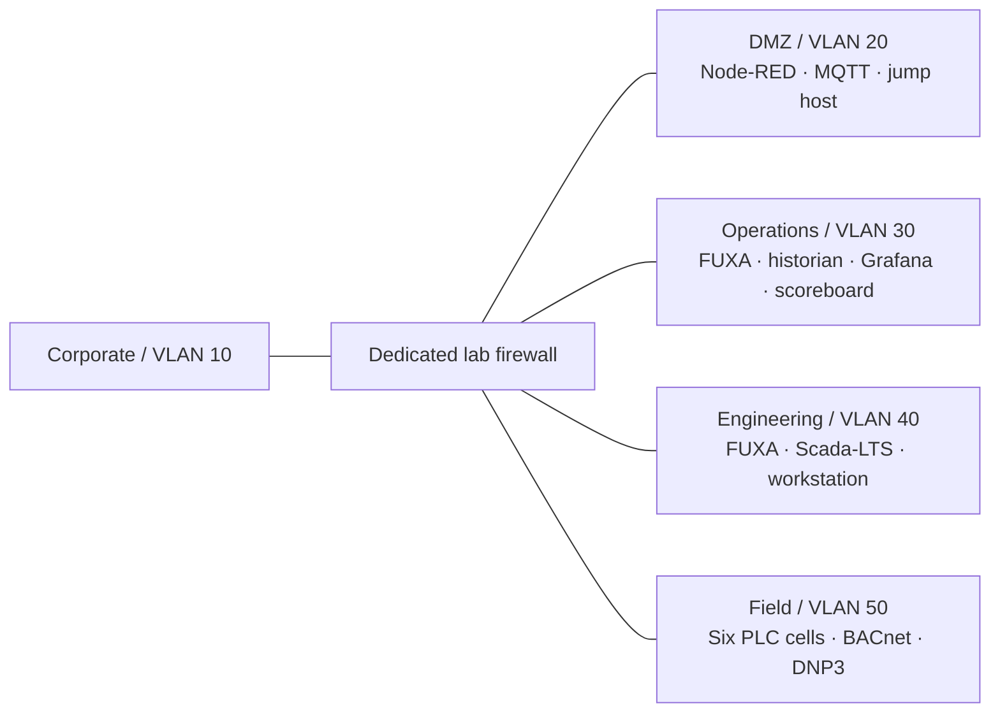

# RSB Brewery ICS Lab

<p align="center"></p>

A segmented industrial cybersecurity training lab: six brewery process cells,
OpenPLC controllers, Modbus TCP, BACnet/IP, DNP3, FUXA, Scada-LTS, a historian,
and an optional Windows domain environment.

**v1.0.0 — first public release.** Build the lab on VMware using the supplied
adapter, or adapt the common guest configuration to another platform. You supply
OS media, licensing and infrastructure. See [tested platforms and limits](docs/support.md).

## What is included

- Six IEC 61131-3 Structured Text programs and Python process simulators.
- Four configurable Docker Compose stacks for the OT services.
- BACnet chiller and DNP3 boiler implementations and health checks.
- Native FUXA process views, eight-source/159-point Scada-LTS exports, Grafana dashboard,
  and Node-RED historian flows with an engineering MQTT channel.
- Windows domain configuration, role installers, and supporting service source.
- A platform-neutral [topology](lab/topology.json), explicit
  [firewall policy](provisioning/firewall/policy.json), local lifecycle tools,
  reset guidance, release checks, and a [porting guide](docs/porting-guide.md).

The complete FUXA project includes **Dashboard-P1, P2, P3 and P4, with all 26 current artwork assets**.
Browse the [live-render gallery](docs/gallery.md) and the
[optional administrator/student VPN guide](docs/vpn.md).

No VM disks, Windows media, VPN profiles, private lab credentials, live database
backups, compiled engineering-agent binaries, or conversation archives are included.

## Choose a scope

| Scope | Machines you provide | Purpose |
|---|---|---|
| OT core | Dedicated lab firewall and Linux Docker VM; a client with access to the lab networks | Process simulation, dashboards, and protocol exercises |
| Full lab | OT core plus AD/DNS server, corporate workstation, DMZ jump host, engineering workstation, optional attack VM | Domain and IT/OT pivot exercises |

The optional [VMware adapter](infrastructure/vmware/README.md) creates independent
OS clones and new isolated networks, then stages guest customization. Other
platforms use the common guest configuration after you create their machines and
networks. Start with
[requirements](docs/requirements.md), [installation](docs/installation.md), and
[networking](docs/networking.md). Windows setup is in [the full lab guide](docs/windows.md).
The tested VMware layout is described in [the reference build guide](docs/vmware.md).



## First steps on your Linux Docker VM

After creating the isolated networks and attaching the guest adapters:

```bash
python3 tools/lab.py init
# Edit .env: set VLAN20_PARENT through VLAN50_PARENT to your Linux interfaces.
python3 tools/lab.py preflight
python3 tools/lab.py build
sudo python3 tools/lab.py prepare-state
sudo python3 provisioning/linux/host-isolation.py --install-service
# Disconnect temporary upstream/build connectivity before starting applications.
python3 tools/lab.py start
python3 tools/lab.py programs
# Create temporary management shims, import projects, and configure authentication
# as described in docs/installation.md. Drivers are included in the image build.
python3 tools/lab.py check
```

Run Docker commands with the account/privileges required by your host. The
initial image build requires internet access; the exercise runs offline after staging.
Use a dedicated Docker guest: container names and lab addresses are fixed.

## Installation and optional exercise material

Database, broker, VPN and administrator credentials are generated locally and
kept out of Git. Follow installation without consulting the solution. Start
exercises with the [student brief](exercises/student/brief.md).

**Optional spoilers:** [Instructor guide, scenario details and account references](exercises/instructor/guide.md).
It describes one possible approach; other paths may work. Public source also
contains exercise details.
See [SECURITY.md](SECURITY.md) and [reset instructions](docs/reset.md).

## Contributing and license

Proxmox, VMware, Hyper-V, and other platform adapters are welcome. Report what
you actually tested using the [acceptance checklist](docs/acceptance.md).
See [CONTRIBUTING.md](CONTRIBUTING.md). Original project material is MIT licensed;
external software retains its own terms: [third-party notices](THIRD_PARTY_NOTICES.md).
