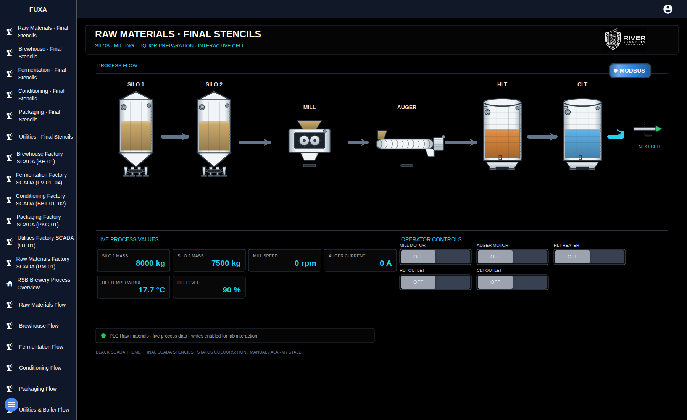
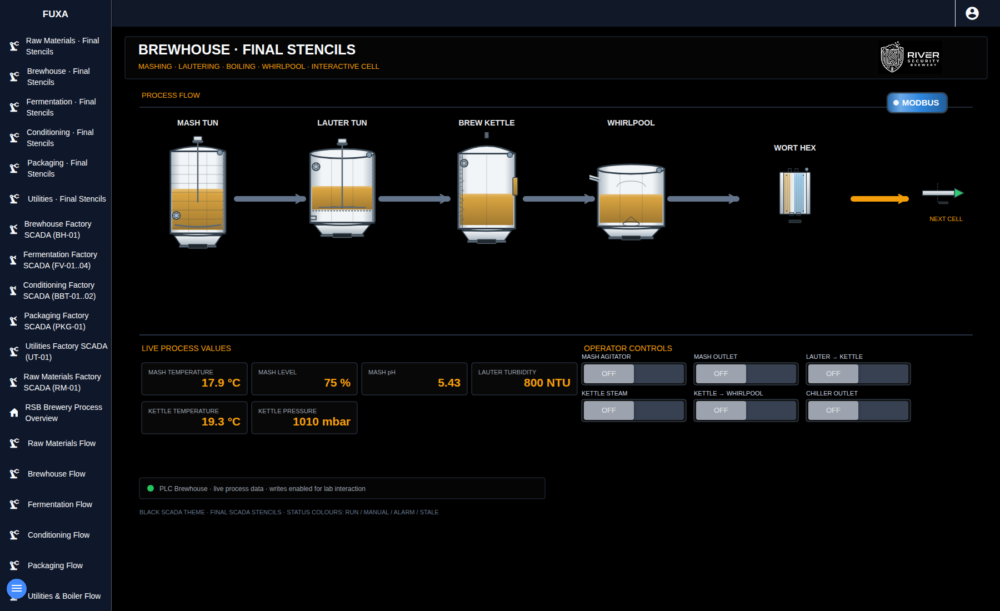
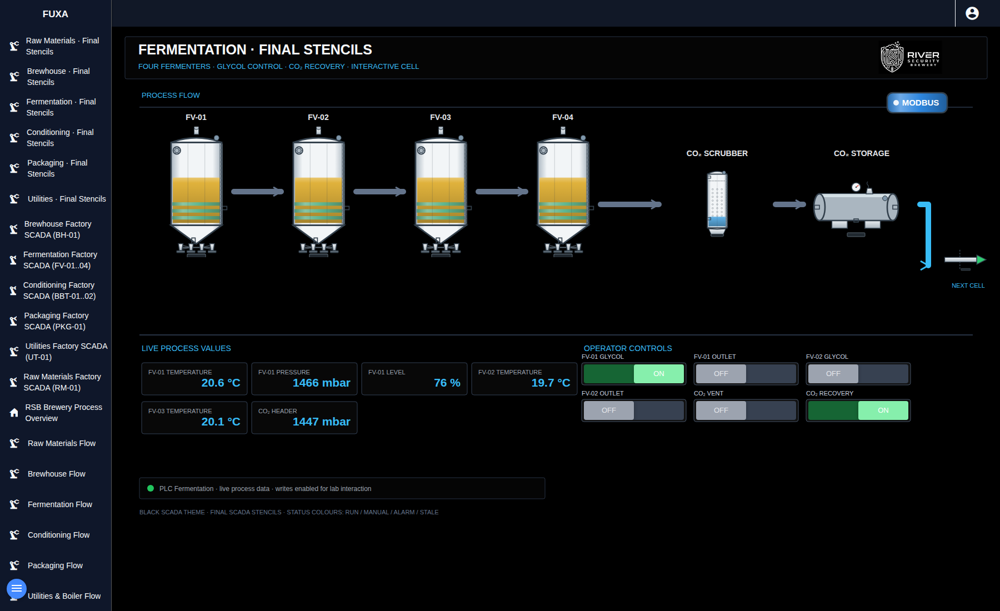
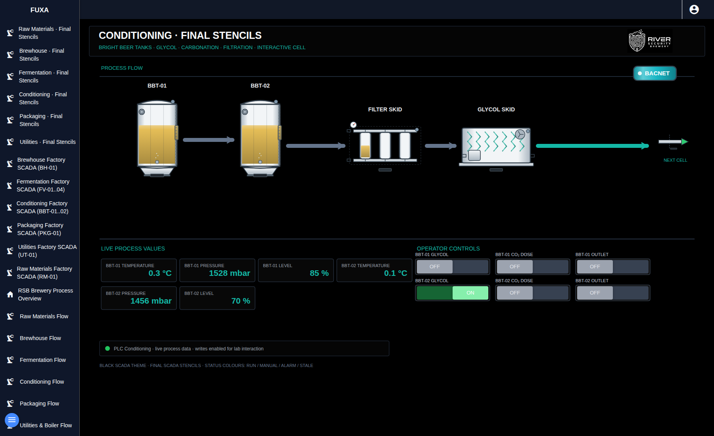
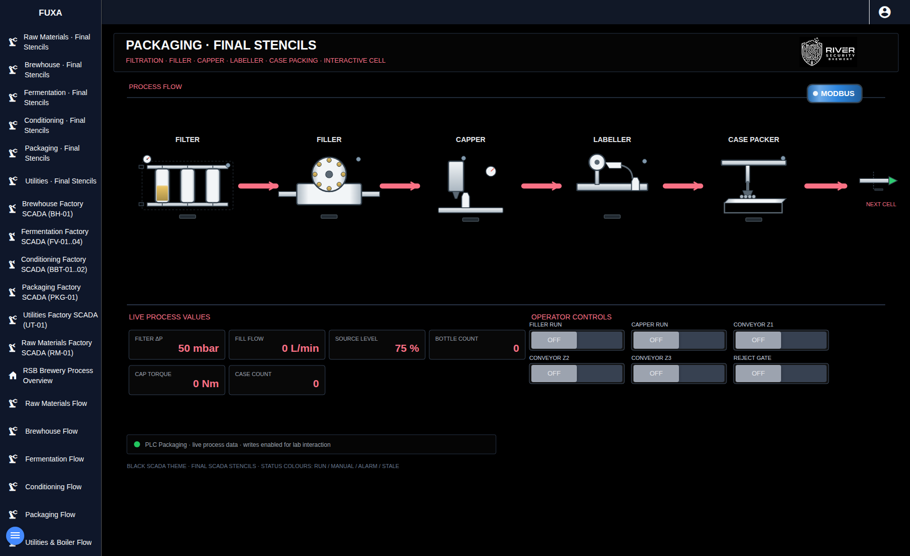
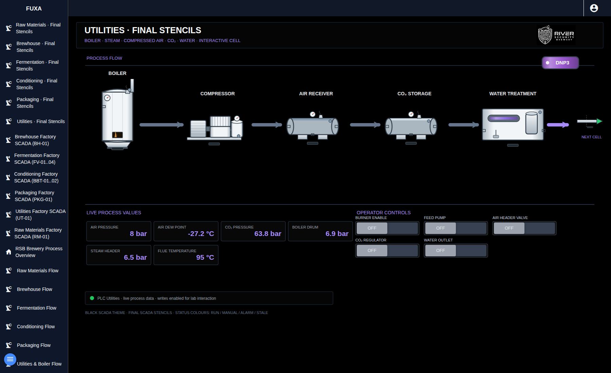

# Brewery screens

These are browser renders from the VMware reference environment, using the
bundled FUXA project and live process values. All 26 views on both instances
passed image decoding and browser-error checks with external requests blocked.
The project includes the logo and every equipment image; no private asset
directory or external image service is required.

## Raw materials

## Brewhouse

## Fermentation

## Conditioning

## Packaging

## Utilities

See the [FUXA project instructions](../projects/fuxa/README.md) for a native export
containing every view and image. Screenshots show a running simulation, so values
will vary between installations.
