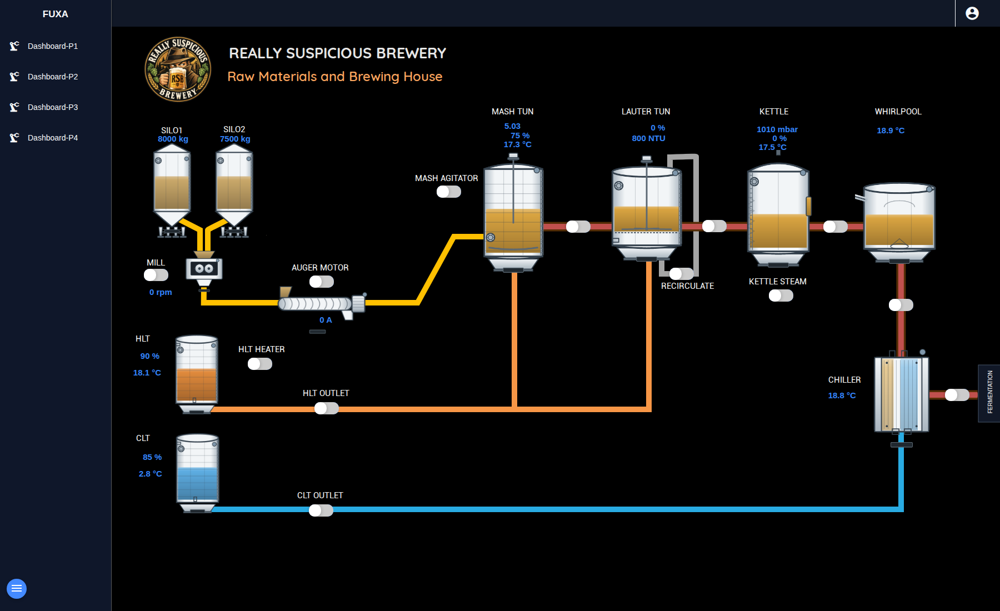
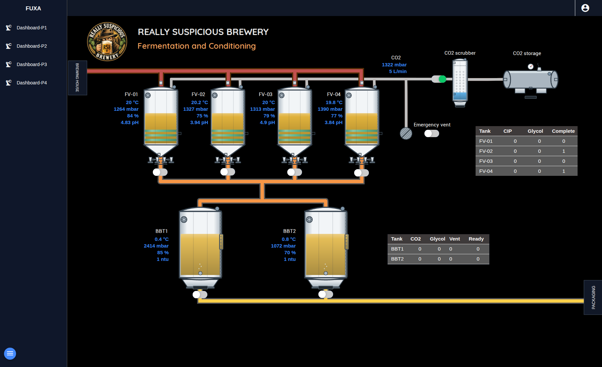
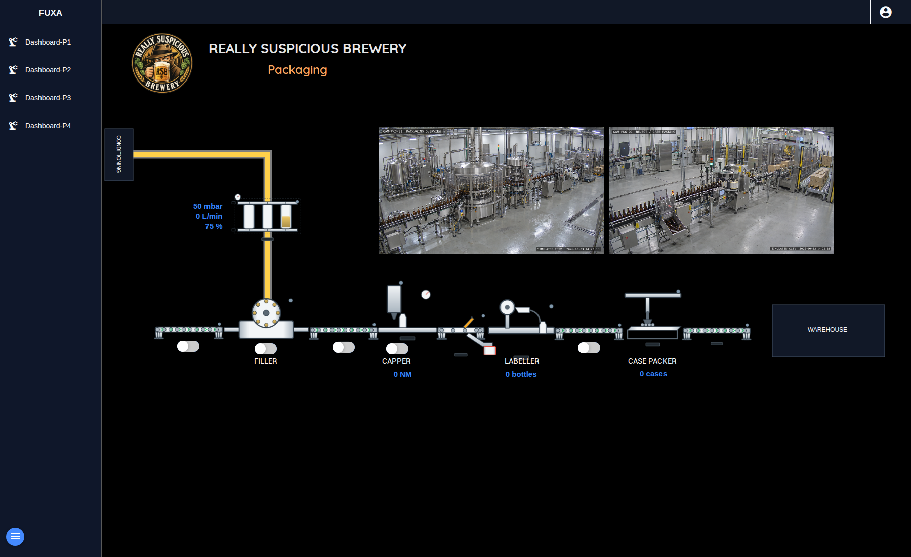
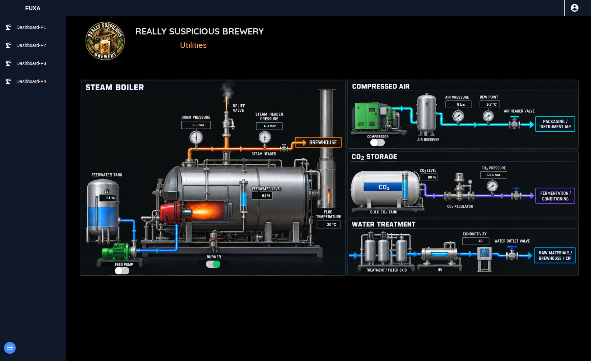

# Current brewery dashboards

The four FUXA dashboards show live simulated process values. All artwork is
bundled with the project.

## Dashboard-P1 — Raw materials and brewing house

## Dashboard-P2 — Fermentation and conditioning

## Dashboard-P3 — Packaging

## Dashboard-P4 — Utilities

The [FUXA project instructions](../projects/fuxa/README.md) cover native export
and upgrading an older installation. Screenshots show a running simulation;
values vary. The same [brewery logo](../projects/fuxa/assets/8a8b99411a0cc214a32a.png)
is used in the repository README and is available as a reusable project icon.
